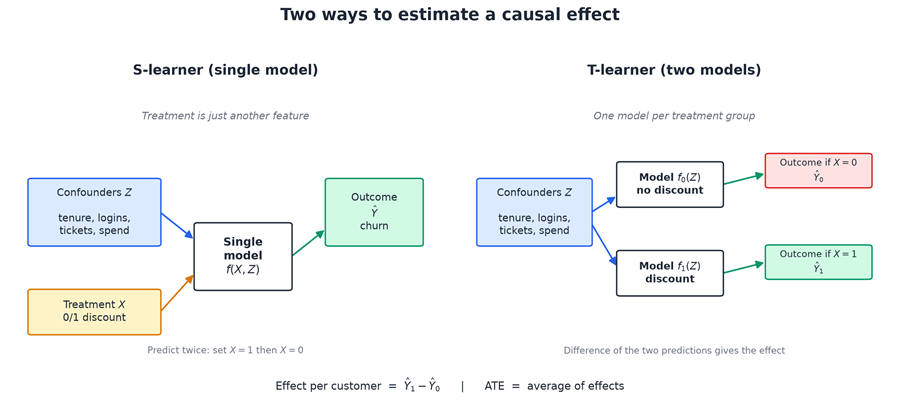
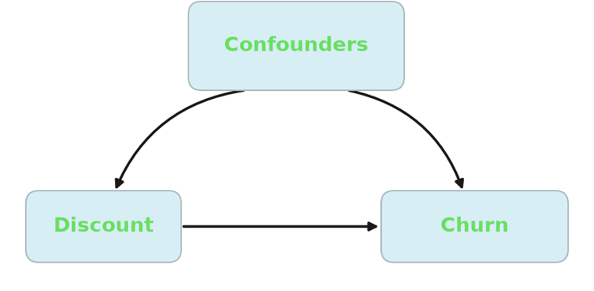
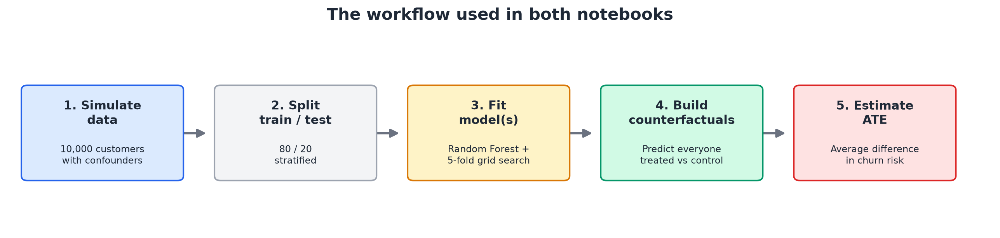
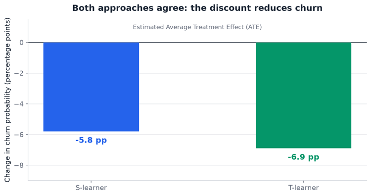
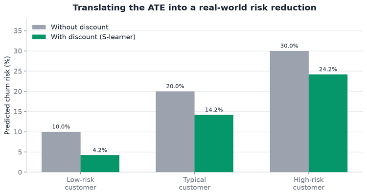

# Causal Inference: S-Learners & T-Learners

In the absence of running an A/B test experiment, this small, hands-on repo shows how to use ordinary machine learning models to estimate a causal effect from observational data.

> **Does offering a $20 discount actually stop customers from churning?**

Instead of just predicting churn, we estimate the **causal effect** of the discount by comparing what would happen if everyone got it versus if no one did. This is useful when an experiment is impractical, too slow, or simply was never run, and you have to work with data that already exists. The repo walks through two classic meta-learners, S-learner and T-learner, side by side on the same synthetic customer dataset.



---

## Why this repo exists

A normal ML model learns *correlations*. But the retention team gives discounts mostly to high-risk customers, so simply comparing churn rates between discounted and non-discounted customers is misleading. That's **selection bias**, caused by **confounders** — things like tenure, app logins, support tickets, and spend that influence both who gets a discount and who churns.

The data in this scenario is **historical** and **observational**. Historical describes *when* it was collected; observational describes *how* the discount was assigned — by the retention team, not at random. That distinction matters: in an A/B test, random assignment makes the groups comparable, while with observational data we have to model our way around the imbalance.



Causal inference corrects for this by asking a counterfactual question for every customer:

- What is the churn risk if this customer **gets** the discount?
- What is the churn risk if this customer **does not** get the discount?

The average difference between those two predictions is the **Average Treatment Effect (ATE)**.

---

## What's inside

| Notebook | Approach | What it does |
| --- | --- | --- |
| [`s_learner.ipynb`](s_learner.ipynb) | **S-learner** | Trains **one** Random Forest with the treatment as an extra feature, then predicts twice. |
| [`t_learner.ipynb`](t_learner.ipynb) | **T-learner** | Trains **two** separate Random Forests, one for the control group and one for the treated group. |
| `cross_fitting_s_learner.ipynb` | Cross-fitting (S) | Placeholder for a future cross-fitted version. |
| `cross_fitting_t_learner.ipynb` | Cross-fitting (T) | Placeholder for a future cross-fitted version. |

Both notebooks follow the same structure:

1. Generate 10,000 synthetic subscription customers with realistic confounders.
2. Split the data 80/20 into train and test sets.
3. Tune a Random Forest with 5-fold cross-validation and grid search.
4. Create two counterfactual worlds: everyone treated, and everyone in control.
5. Average the difference in predicted churn to get the ATE.



---

## The two approaches at a glance

**S-learner (single model)** — put the treatment column in with the other features and train one model. To estimate the effect, ask the model to predict the same customers twice: once with the discount switched on, once switched off. Simple and fast, but tree-based models can sometimes underuse the treatment column if other features are very predictive.

**T-learner (two models)** — split the training data by treatment status and fit a separate model to each group. Because the treatment is never a feature, the models are forced to learn the two groups independently. This avoids the S-learner's "ignored treatment" risk, at the cost of training two models and having less data for each.

---

## Before you trust the estimate

Without randomisation, a causal estimate is only as good as its assumptions. The main ones are:

- **No unmeasured confounding** — every variable that affects both the discount and churn is measured and included.
- **Overlap (positivity)** — every kind of customer has a realistic chance of appearing in both the treated and control groups.
- **Consistency** — "receiving the discount" means the same thing for every customer.

Machine learning does not create causality by itself. It helps estimate the counterfactual outcomes once the study design and these assumptions are reasonable.

---

## Results

The two methods land in the same neighbourhood, which is a good sign that the effect is stable:



| Model | Estimated ATE | Plain-English meaning |
| --- | --- | --- |
| S-learner | **-5.8 percentage points** | The discount lowers churn probability by about 5.8 points. |
| T-learner | **-6.9 percentage points** | The discount lowers churn probability by about 6.9 points. |

Because churn is coded as `1 = churned`, a **negative** effect is good news: the discount pushes churn down. The effect is absolute, not relative — a customer with a 20% baseline risk drops to roughly 14.2% under the S-learner estimate.



---

## Quick start

The notebooks are self-contained and use only common Python data-science libraries.

```bash
pip install numpy pandas scikit-learn matplotlib
```

Then open either `s_learner.ipynb` or `t_learner.ipynb` and run the cells top to bottom. The grid search takes a few minutes on a typical laptop.

---

## Repo structure

```
causal_inference/
├── README.md
├── s_learner.ipynb
├── t_learner.ipynb
├── cross_fitting_s_learner.ipynb   # empty placeholder
├── cross_fitting_t_learner.ipynb   # empty placeholder
└── images/
    ├── s_vs_t_learner.png
    ├── workflow.png
    ├── confounding.png
    ├── ate_comparison.png
    ├── churn_risk_example.png
```

---

## A note on the data

The dataset is **synthetic** and generated inside the notebooks, so results are reproducible with a fixed seed. The data generator plants a known causal effect, which makes it a safe sandbox for checking whether each learner recovers the right direction and rough magnitude. Real-world observational work would also need careful study design, overlap checks, and sensitivity analysis for unmeasured confounding.